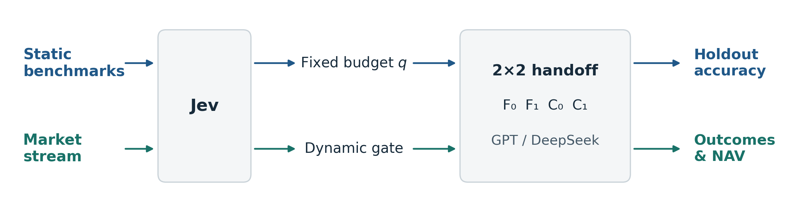
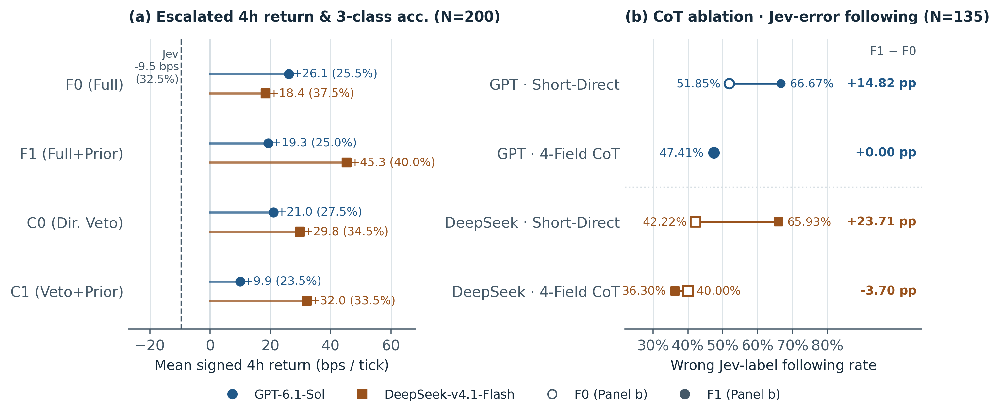
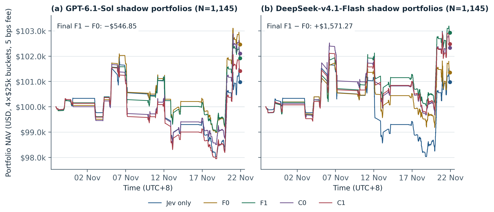

<div align="center">

# Hybrid Probabilistic–Generative Cascades

### *When Does Showing a Small Model's Prior Help vs. Hurt Frontier Reasoning Models?*

[](Hybrid_Cascade_System_Preprint.pdf)
[](requirements.txt)
[](#headline-empirical-findings)
[](#quickstart-zero-cost-offline-verification)

**Official implementation, streaming sandbox, and full API replay archives for:**
*Prior-Assisted Handoff, Cognitive Anchoring, and Dynamic Governance in Hybrid Probabilistic--Generative Cascades* — **Jieren Guan**

[Read the Preprint PDF](Hybrid_Cascade_System_Preprint.pdf) • [60-Second Walkthrough](#how-the-system-works) • [Zero-Cost Quickstart](#quickstart-zero-cost-offline-verification) • [Full Reproduction](#full-reproducibility-guide)

</div>

---

## Why This Project Exists

Routing every user query to frontier reasoning LLMs (**System-2**, e.g., `gpt-6.1-sol`) explodes latency and token bills, while cheap probabilistic classifiers (**System-1**, e.g., `jev-1.14.0` at `$0.042/1M` input tokens) miscalibrate under domain shift.

**The naive intuition:** When System-1 escalates a hard example to System-2, pass along System-1's top predictions and probabilities (`F1`)—or prune candidates to System-1's Top-2 (`C0/C1`)—so System-2 solves it faster and better.

**What we actually discovered across 42,035 live API calls (`$46.53` total audited spend):**
> **It depends completely on decision structure.** On static short-answer benchmarks (`N = 9,280`), exposing System-1's prior triggers **cognitive anchoring** (automation bias) that drags down GPT accuracy, and Top-2 pruning erases true labels behind an insurmountable **recall ceiling**. Yet inside a noisy real-time market/news stream (`N = 1,145` live 30m Alpaca ticks), pairing **explicit 4-field Chain-of-Thought stance critique** with an **anti-avalanche dynamic gatekeeper** suppresses wrong-prior anchoring, slashes escalations by **82.53%**, and delivers consistent post-fee portfolio alpha across all eight CoT cascade arms.

<div align="center">
  
  <br />
  <sub><em>End-to-end dual-track study pairing <code>jev-1.14.0</code> (System-1) with <code>gpt-6.1-sol</code> and <code>deepseek-v4.1-flash</code> (System-2) across static benchmarks and a real-time financial stream.</em></sub>
</div>

---

## Headline Empirical Findings

| Dimension | Static Benchmark Track (`N = 9,280`) | Streaming Financial Track (`N = 1,145` Ticks) |
| :--- | :--- | :--- |
| **Calibration & Routing** | $L_2$-logistic cuts Brier by **-10.57%** (`0.1888 -> 0.1688`); `1-p1` routing gains **+7.77 pp** over System-1 at `q=25%` (`6.17x` cheaper than full GPT) | Three-layer governor escalates just **17.47%** of ticks (**82.53% load cut** vs. `50.39%` fixed threshold; zero fallbacks) |
| **Prior Injection (`F1` vs. `F0`)** | Mild negative drift on GPT (**-0.3080 pp**, raw `p=0.047`); wrong-prior following jumps **+18.60 to +20.93 pp** on fine-grained errors | **Controlled Prompt Inversion:** `Short-Direct` causes **+14.82 / +23.71 pp** excess following; mandatory **4-field CoT** lowers it to **0.00 / -3.70 pp** |
| **Candidate Truncation (`C0/C1`)** | **-1.94 pp** (GPT) & **-1.29 pp** (DeepSeek) loss (`p < 0.001`); Banking77 Top-2 covers only **72.9%–76.2%** gold labels | Upstream directional veto (`K=3`) blocks **38.00%** (`76/200`) Rank-3 contrarian reversals |
| **Economic & Portfolio Alpha** | Standalone `deepseek-v4.1-flash` (`82.11%`, `$0.23/1k`) dominates offline GPT static cascades (`80.21%`, `$0.93/1k`) | After unscaled **5 bps** fees, all 8 CoT arms beat System-1 (`DeepSeek F1`: **+45.30 bps/tick**, **+2.93% NAV**, Sharpe **3.139** vs. `1.050`) |

<div align="center">
  
  <br />
  <sub><em><b>(a)</b> Every cascade arm turns System-1's negative expectancy (<code>-9.5 bps</code>) positive; unconstrained action selection beats directional veto. <b>(b)</b> Controlled in-track ablation on the exact <code>135</code> System-1 error ticks proves 4-field CoT neutralizes excess anchoring.</em></sub>
</div>

<br />

<div align="center">
  
  <br />
  <sub><em>Four-bucket shadow portfolio NAV (<code>4 x $25,000</code>, unscaled <code>5 bps</code> one-way turnover fee) over <code>1,145</code> live Alpaca ticks: all GPT CoT arms outperform standalone System-1, while DeepSeek <code>F1</code> reaches <code>$102,929.04</code> (Sharpe <code>3.139</code>).</em></sub>
</div>

---

## How the System Works

1. **System-1 Fast Prior (`jev-1.14.0`):** Emits calibrated $K$-way action distributions $\mathbf{p}$ (`Choice`) or binary truth probabilities $p_{\text{yes}}$ (`Noul`) at sub-cent token cost (`$0.042/1M` input, `$0` output).
2. **Dynamic Anti-Avalanche Gatekeeper (Track 2):** Replaces brittle static uncertainty cutoffs with three cascading guards:
   - *48h Rolling-Quantile Filter*: escalates only tail epistemic uncertainty ($\text{PR}(u_t) \ge 0.75$ across `W=384` ticks).
   - *60-Min Ticker Cooldown*: suppresses clustered volatility bursts unless a fresh breaking-news ID overrides it.
   - *Hourly Token Bucket + Killswitch*: caps burst rate (`4` tokens, `+1/30m`) with hard USD circuit breakers (`$16.00` global ceiling).
3. **2 × 2 Orthogonal Handoff Protocol:** Dispatches escalated ticks identically across **`F0`** (blind full space), **`F1`** (full space + System-1 Top-2 priors), **`C0`** (blind Top-2 pruned / Rank-3 veto), and **`C1`** (Top-2 pruned + priors), alongside in-track **`Short-Direct`** and placeholder-free **`F0-Clean`** ablations.
4. **Dual-Tier Financial Evaluation:** Pairs tick-level continuous trading expectancy (`Active Win%`, `Payoff Ratio`, `Mean Directional Return`) with a four-bucket portfolio backtest scaling only return overlap by $\Delta t / H = 1/8$ while deducting full unscaled $5$~bps turnover friction.

---

## Quickstart: Zero-Cost Offline Verification

You can inspect and verify the **exact Track 2 empirical tables, gatekeeper counts, Tier-1 continuous returns, Tier-2 four-bucket NAVs, and controlled CoT ablations** directly from our frozen real-market archives **without spending any API credits**:

```bash
# 1. Clone & install dependencies (Python 3.12 recommended)
git clone https://github.com/McKrispy/Hybrid-cascade-system.git
cd Hybrid-cascade-system
pip install -r requirements.txt

# 2. Recompute all Track 2 metrics from archives/track2_alpaca_real/
python scripts/track2/verify_track2_offline.py

# 3. Run standalone offline infrastructure, routing, handoff & sandbox unit tests
pytest tests/test_b00_infra.py tests/test_b02_baseline.py tests/test_b04_routing.py tests/test_b05_handoff.py tests/test_b08_sandbox.py -q
```

---

## Repository Structure

```text
.
├── Hybrid_Cascade_System_Preprint.pdf   # Unified 8-page main-body IEEE preprint (+ Refs & Appendices)
├── .env.example                         # Environment variable template for live API runs
├── requirements.txt                     # Core Python dependencies
├── requirements-lock.txt                # Exact pinned package lockfile
├── environment.yml                      # Conda environment specification
├── run.py                               # Track 1 batch orchestrator (B00–B07)
├── reproduce.py                         # Track 1 offline replayer, tables & figure generator
├── configs/                             # Experiment hyperparameters & deterministic budgets
├── data/                                # Group-isolated split manifests & routing masks (seed=42)
├── src/                                 # Core modules (clients, calibration, routing, handoff, eval)
├── sandbox/                             # Self-contained streaming financial daemon & Docker setup
├── archives/track2_alpaca_real/         # Frozen 1,145-tick Alpaca stream, replay ledgers & ablation JSONLs
├── scripts/
│   ├── download_raw_data.py             # Track 1 benchmark downloader
│   └── track2/                          # Stream builder, live replay/ablation runners & offline verifier
├── assets/                              # README showcase figures
└── tests/                               # Unit & contract test suite
```

---

## Full Reproducibility Guide

### 1. Environment & API Credentials (Live Runs Only)

Using **Conda** (optional alternative to `pip`):
```bash
conda env create -f environment.yml
conda activate hybrid_cascade
```

For live API execution or fresh Alpaca data ingestion, copy `.env.example` to `.env` (and `sandbox/.env`) and populate:
- `TYPESAFE_API_KEY` — System-1 (`jev-1.14.0`, `POST /v1/systemone`)
- `OPENAI_API_KEY` — System-2A (`gpt-6.1-sol`)
- `DEEPSEEK_API_KEY` — System-2B (`deepseek-v4.1-flash`)
- `APCA_API_KEY_ID`, `APCA_API_SECRET_KEY` — Alpaca Market Data & News API (Free Tier)
- `TELEMETRY_BEARER_TOKEN` — Bearer secret for the `:8090` telemetry API

### 2. Track 1: Static Benchmark Suite (`N = 9,280`)

Download raw datasets (`Banking77`, `CLINC150`, `ANLI R2/R3`, `StrategyQA`), reconstruct deterministic `seed=42` group-isolated splits (`Calibration=1,856`, `Selection=928`, `Holdout=6,496`), and run the full pipeline:

```bash
python scripts/download_raw_data.py
python run.py --batch B00   # API connectivity smoke test
python run.py --batch B01   # Group-stratified ingestion & split manifests
python run.py --batch B02   # System-1 & blind F0 System-2 development baselines
python run.py --batch B03   # Calibrators: isotonic / L2-logistic / temperature
python run.py --batch B04   # Selective routing masks (q in {15%, 25%, 35%})
python run.py --batch B05   # Prior handoff (F1) & Top-2 pruning (C0/C1)
python run.py --batch B06   # Probability-stripped FR mechanism controls
python run.py --batch B07   # Frozen blind Holdout evaluation (N=6,496)

# Regenerate offline tables and figures from saved runs/ artifacts
python reproduce.py
```

Once `download_raw_data.py` and `run.py` complete, run the remaining archive-backed Track 1 tests:
```bash
pytest tests/test_b01_input.py tests/test_b03_calibration.py tests/test_b06_fr_control.py tests/test_b07_holdout.py tests/test_p02_offline_reproduction.py -q
```

### 3. Track 2: Live Alpaca Stream & Containerized Sandbox

```bash
# Optional: fetch a fresh 30m OHLCV + news stream from Alpaca
python scripts/track2/build_alpaca_real_stream.py

# Re-execute live System-1/System-2 replay & controlled prompt ablations (incurs API billing)
python scripts/track2/run_alpaca_real_replay.py
python scripts/track2/run_alpaca_short_ablation.py
python scripts/track2/run_alpaca_f0_clean_ablation.py

# Or launch the self-contained 24/7 sandbox daemon via Docker
cd sandbox
docker compose up --build
```

---

## Citation

```bibtex
@misc{guan2026hybridcascade,
  title  = {Prior-Assisted Handoff, Cognitive Anchoring, and Dynamic Governance in Hybrid Probabilistic--Generative Cascades},
  author = {Guan, Jieren},
  year   = {2026},
  note   = {Preprint and reproducibility archive: \url{https://github.com/McKrispy/Hybrid-cascade-system}}
}
```

---

## AI Disclosure Statement & Financial Disclaimer

- **AI Disclosure Statement:** The probabilistic prior model (`jev-1.14.0`) and generative reasoning models (`gpt-6.1-sol` and `deepseek-v4.1-flash`) are the experimental subjects under evaluation. Generative AI and coding-assistant tools were used to support software engineering automation, experimental telemetry scripting, and manuscript editing/translation under full human author verification and responsibility.
- **Financial Disclaimer:** The Track 2 streaming financial sandbox, technical-news synthesis, directional signals, and simulated portfolio NAV trajectories are provided strictly for academic machine learning research and runtime cascade governance evaluation. Nothing in this repository constitutes financial, investment, or trading advice, and simulated backtest performance does not guarantee future returns.
